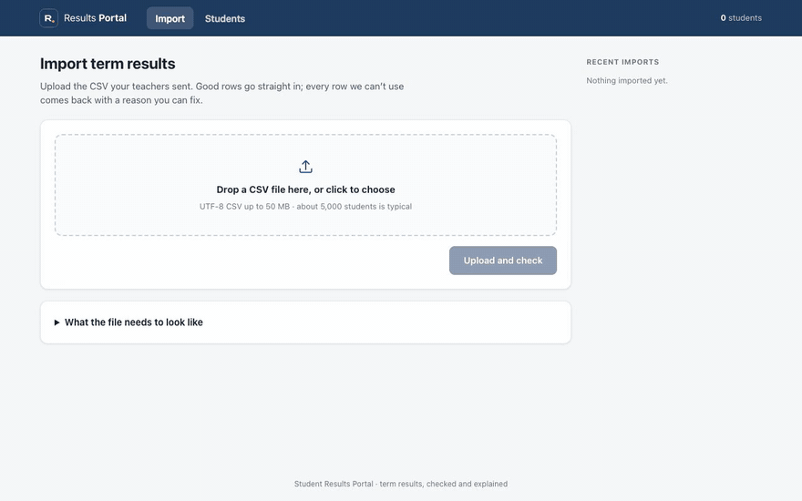
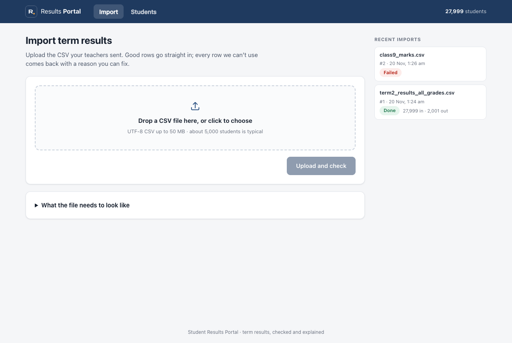
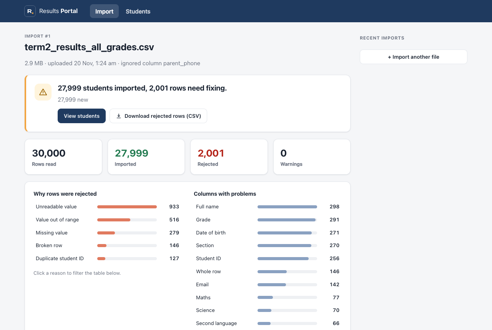
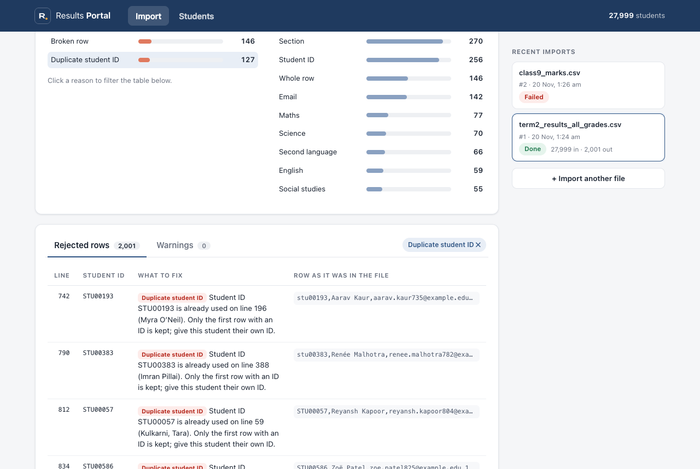
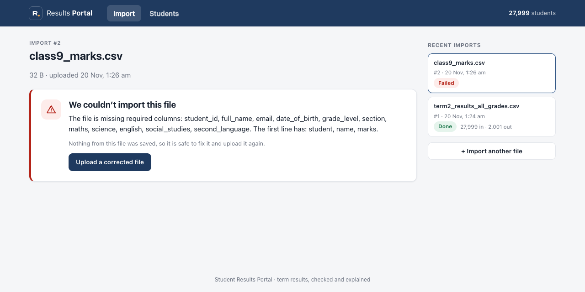
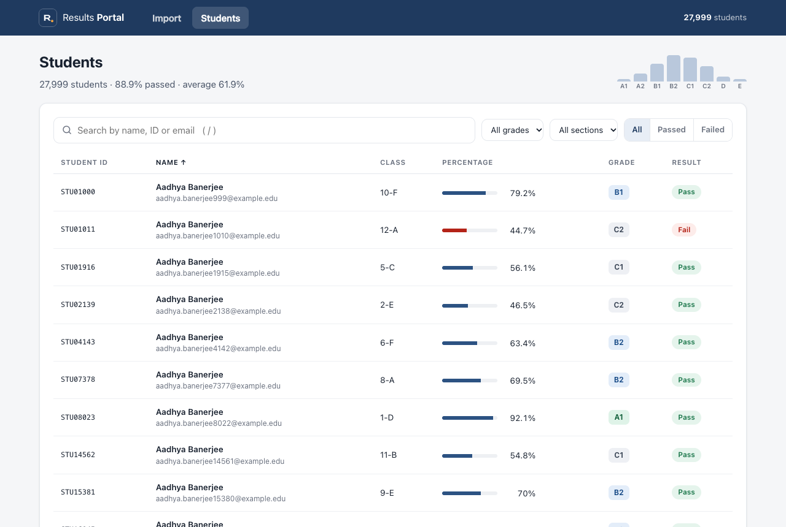
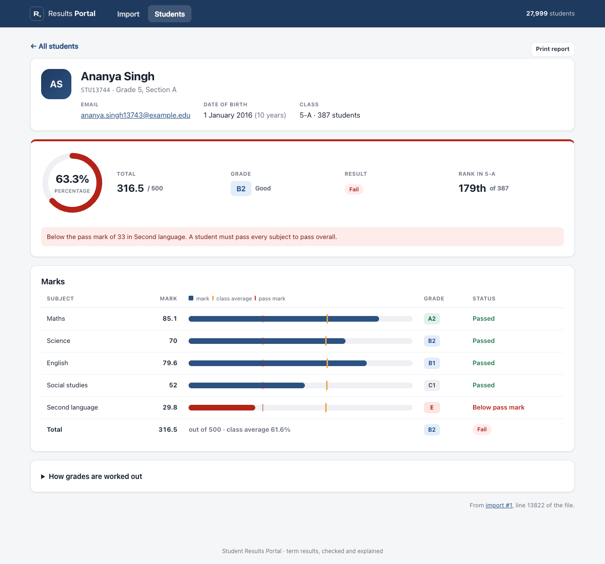
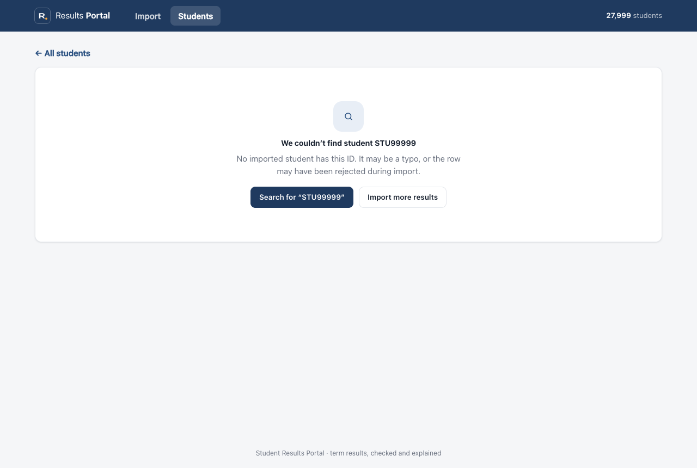
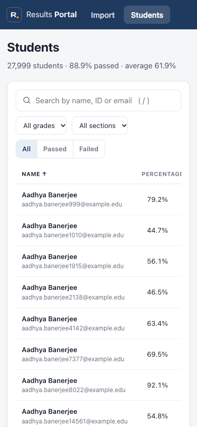
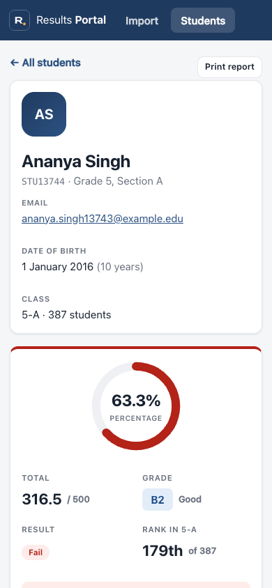

# Student Results Portal

A small web portal for a school administrator. Upload the messy term-results CSV your teachers send; the good rows go straight in, every bad row comes back with a reason a non-developer can act on, and any student's report is one search away.

Built as the Es Magico full-stack intern take-home. Decisions and trade-offs are in **[NOTES.md](NOTES.md)**.



**Full walkthrough with captions (2½ min):** [docs/media/demo.mp4](docs/media/demo.mp4)

| | |
|---|---|
| ✅ Sample pack numbers match exactly | `students_small.csv` → 25 read, **16** in, **9** out · `students_sample.csv` → 5,000 read, **4,685** in, **315** out |
| 🧪 152 tests, about 2 s | including an independent oracle: 12 random messy files checked line by line |
| 🐳 One Dockerfile | builds the frontend and runs API + UI on port 3000 |
| 🧹 Nothing crashes | Excel files, PDFs, Latin-1 text, unclosed quotes, missing columns, 50 MB+ files: each gets a clear message |

---

## Run it

### With Docker (recommended)

```bash
docker build -t student-results-portal .
docker run --rm -p 3000:3000 -v portal-data:/app/data student-results-portal
```

Open **http://localhost:3000**. Load 5,000 messy demo students into the running container:

```bash
docker exec $(docker ps -q --filter ancestor=student-results-portal) node scripts/seed.ts --load
```

### Without Docker (Node 24+)

```bash
npm install
npm run build        # builds the frontend into dist/web
npm start            # API + UI on http://localhost:3000
```

For development with hot reload, run `npm run dev` (API on :3000, Vite on :5173 with a proxy).

### Tests

```bash
npm test             # 152 tests: reader, rules, grading, API, import end to end, oracle
npm run typecheck
```

To also check the official counts, put `students_small.csv` and `students_sample.csv` in `./sample-pack/` (git-ignored, since the pack is confidential) and run `npm test` again.

### Seed data

```bash
npm run seed                          # data/seed/students_seed.csv + an answer key (.expected.json)
npm run seed -- --rows 30000 --seed 7 # bigger, different, still repeatable
npm run seed -- --load                # also upload it to the running portal
```

| Setting | Default | |
|---|---|---|
| `PORT` | `3000` | |
| `DATA_DIR` | `./data` (`/app/data` in Docker) | SQLite file and temporary uploads |
| `SCHOOL_TIMEZONE` | `Asia/Kolkata` | "today" for the 5–25 age rule |
| `MAX_UPLOAD_MB` | `50` | |

---

## The three screens

### Import (`/import`)

Drop a CSV, watch it being checked, then see exactly what happened.





- **Plain-language reasons,** grouped by type and by column. Click a reason to filter the table.
- **Every rejected row** shows its file line number (header = line 1, blank lines counted), every problem in that row, and the row as it was in the file.
- **Download rejected rows (CSV):** the teacher fixes them in Excel and sends them back.
- **Warnings** for rows that are valid but suspicious (two students sharing an email, an existing ID arriving with a new name). They are imported and flagged, not silently accepted.
- **Same file twice** is caught by fingerprint and the admin is asked first.



| Bad file | What the admin sees |
|---|---|
|  | Missing columns refuse the whole file, list what is missing and what was found, and confirm **nothing was saved**. |

### Students (`/students`)



- Server-side search over ID, name and email. **Accents don't matter:** `zoe` finds *Zoë*, `bjorn` finds *Bjørn*. Every word must match, so `aarav singh` works in any order.
- Filter by grade, section and pass/fail; sort by any column; 25/50/100 per page. **All of it lives in the URL**, so back/forward and shared links work.
- Loading skeletons, an empty-portal state that points to Import, and a "no matches" state with one-click reset. Press `/` to jump to search.

### Student report (`/students/:id`)



- Total, percentage, grade, pass/fail and **rank in class**, with each mark drawn against the **class average** and the **pass mark**.
- A failed student is told *why* ("Below the pass mark of 33 in Second language").
- Print-friendly. Links back to the import and file line the data came from.
- An unknown ID gets a helpful page, not a blank one:



<p>


</p>

---

## Grading scheme

CBSE-style 8-point scale, which Indian school staff already know:

| A1 | A2 | B1 | B2 | C1 | C2 | D | E |
|---|---|---|---|---|---|---|---|
| 91–100 | 81–90 | 71–80 | 61–70 | 51–60 | 41–50 | 33–40 | < 33 |

Total is out of 500, percentage = total / 5, grade from the rounded percentage. **A student passes only if every subject is 33 or more.** One weak subject fails the student even with a high average, and the report says which one.

```ts
// server/grading.ts
export function computeResult(marks: Record<Subject, number>): Result {
  const total = round2(SUBJECTS.reduce((sum, s) => sum + marks[s], 0));
  const maxTotal = SUBJECTS.length * MAX_PER_SUBJECT;
  const percentage = round2((total / maxTotal) * 100);
  const failedSubjects = SUBJECTS.filter((s) => marks[s] < PASS_MARK);
  return {
    total,
    maxTotal,
    percentage,
    grade: gradeFor(percentage),
    passed: failedSubjects.length === 0,
    failedSubjects,
  };
}
```

---

## How the import works

```
 upload ──► save to disk while hashing + sniffing  ──► 202 { importId }
            (.xlsx / PDF / binary refused here)              │
                                                              ▼
            background queue (one import at a time) ── UI polls /api/imports/:id
                                                              │
   stream bytes ──► CSV reader ──► header map ──► validate row ──► accepted[] / rejected[]
   (UTF-8 check,     (line numbers,  (any order,    (all problems,     progress saved
    BOM stripped)     quotes, CRLF)   extra cols ok) first ID wins)     every 250 rows
                                                              │
                                                              ▼
                       ONE transaction: upsert students + store errors + final counts
```

**All or nothing per file.** Rows are validated first and written in a single transaction, so a crash or a file that breaks at line 4,000 never leaves half an import behind. Bad *rows* never block good rows.

Each rule returns either a clean value or a problem written for the admin:

```ts
// server/import/rules.ts
export function section(v: string): Result<string> {
  if (/^[A-Fa-f]$/.test(v)) return ok(v.toUpperCase());
  if (/^[A-Za-z]$/.test(v)) {
    return fail("OUT_OF_RANGE", "section", `Section ${quote(v)} does not exist; sections run from A to F.`);
  }
  return fail("INVALID_FORMAT", "section", `Section ${quote(v)} must be a single letter from A to F.`);
}
```

The first row with an ID owns it, even when that row is invalid, and the duplicate message says who owns it:

```ts
// server/import/validate-row.ts
const owner = key ? seenIds.get(key) : undefined;
if (owner) {
  const who = owner.name ? ` (${owner.name})` : "";
  problems.push({
    code: "DUPLICATE_ID",
    field: "student_id",
    message: `Student ID ${key} is already used on line ${owner.line}${who}. Only the first row with an ID is kept; give this student their own ID.`,
  });
} else if (key) {
  seenIds.set(key, { line, name: value("full_name").replace(/\s+/g, " ") });
}
```

### Traps found in the sample data

| Trap | Example | Handling |
|---|---|---|
| Byte order mark + Windows line endings | `EF BB BF`, `\r\n` | stripped / both accepted |
| Extra column | `parent_phone` | ignored, and listed on the import page |
| Padding and case | `"  A "`, `stu00022`, `ADITYA@EXAMPLE.EDU` | trimmed, upper-cased ID and section, lower-cased email |
| Duplicate IDs that are *different* people | `stu00533` after `STU00533` | rejected; the message names the first owner |
| Impossible dates | `31/02/2012`, `2011-13-04` | `INVALID_FORMAT` |
| Wrong date style | `11-30-2010`, `14.03.2011`, `tomorrow` | `INVALID_FORMAT` with the accepted formats |
| Ages | born 1970, 2023, 2031 | `OUT_OF_RANGE` with the computed age |
| Marks that aren't numbers | `1e3`, `82/100`, `N/A`, `eighty` | `INVALID_FORMAT` |
| Marks out of range | `-5`, `100.5`, `105` | `OUT_OF_RANGE` |
| Grades and sections | `IX`, `ten`, `9th`, `0`, `13`, `Z`, `AB` | format vs range told apart |
| Broken rows | 11 or 13 fields | `WRONG_FIELD_COUNT`, with the likely cause |
| Unicode names | `Zoë D'Souza`, `Bjørn`, `Ritu Kumārī`, `"Singh, Aarav"` | accepted, and searchable without accents |
| Shared emails | two different students, one email | imported with a warning |

---

## Testing: how I'd convince a teammate

```bash
npm test
```

| Suite | What it proves |
|---|---|
| `csv-reader.test.ts` | Line endings, BOM, quotes, embedded newlines, invalid UTF-8. **Feeds files one byte at a time,** which caught a real bug (an escaped `""` split across chunks). |
| `rules.test.ts` | Every column rule as a table, including the 5th birthday *today*, turning 26 today, and 29 Feb. |
| `import.test.ts` | A hand-made messy fixture checked **line by line**; duplicates, re-uploads, updates, warnings; Excel/PDF/binary/Latin-1/oversize files; 20,000 rows. |
| `generated.test.ts` | **Independent oracle:** the seed generator records which rows it broke and why. 12 random files must match that answer key exactly. |
| `students-api.test.ts` | Search (accents, multi-word, `%`/`_` are not wildcards), filters, sorting, paging, junk parameters, 404s. |
| `sample-pack.test.ts` | The official 16/9 and 4,685/315 counts, when the confidential pack is present locally. |

```ts
// tests/generated.test.ts
it.each([1, 2, 3, 4, 5, 6, 7, 8, 9, 10, 11, 12])("seed %i", async (seed) => {
  const { csv, expected } = generate({ rows: 600, seed, today: TODAY, errorRate: 0.2 });
  const { app } = await testApp();
  const { import: imp } = await importAndWait(app, `gen-${seed}.csv`, csv);
  const { errors } = (await app.inject("/api/imports/1/errors?pageSize=200")).json();
  expect(Object.fromEntries(errors.map((e) => [e.line, e.code]))).toEqual(expected.errors);
  expect(imp).toMatchObject({ accepted: expected.accepted, rejected: expected.rejected });
});
```

CI (GitHub Actions) runs typecheck, tests and build, then builds the Docker image, seeds it and smoke-tests it.

---

## API

| Method | Path | |
|---|---|---|
| `POST` | `/api/imports` | multipart `file`. `202` with the import; `409 DUPLICATE_FILE` for a file already imported (add `?force=1` to import anyway); `413`, `415`, `422` for bad uploads |
| `GET` | `/api/imports` | recent imports |
| `GET` | `/api/imports/:id` | status, progress, counts, summary by reason and column |
| `GET` | `/api/imports/:id/errors` | `?page&pageSize&code&severity=error\|warning` |
| `GET` | `/api/imports/:id/errors.csv` | rejected rows with reasons, opens in Excel |
| `GET` | `/api/students` | `?q&grade&section&result=pass\|fail&sort=name\|id\|class\|percentage&dir&page&pageSize` |
| `GET` | `/api/students/:id` | report: details, marks, result, class context (case-insensitive ID) |
| `GET` | `/api/stats` · `/api/grading` · `/api/health` | |

Errors always look like `{ "error": { "code": "…", "message": "…" } }`, and the message is safe to show to the admin.

## Project layout

```
server/
  import/csv-reader.ts     streaming CSV reader with line numbers
  import/rules.ts          one function per column rule, admin-friendly messages
  import/validate-row.ts   header mapping + row validation + duplicate tracking
  import/importer.ts       background queue, validate then write in one transaction
  grading.ts               grading scheme
  db.ts                    SQLite schema
  uploads.ts               save + hash + sniff uploads
  routes/                  imports, students
web/src/
  pages/                   ImportPage, StudentsPage, StudentReportPage, NotFoundPage
  components/ui.tsx        badges, pager, empty/error/loading states
scripts/
  generate.ts              messy data generator with an answer key
  seed.ts                  CLI: write and optionally load seed data
tests/                     152 tests (Vitest)
```
